<h1 align="center">ONE MORE</h1>

<p align="center">
  <i>An ink-born survival. One brush. Six scrolls. The paper never ends.</i>
</p>

<p align="center">
  
</p>

<p align="center">
  vanilla JS · Canvas 2D · zero dependencies · zero build · full PWA · MIT
</p>

---

**ONE MORE** is a Vampire-Survivors-like painted as living sumi-e, written in
vanilla HTML/CSS/JS. You are a brush spirit walking sheets of washi paper;
your brush **is** your weapon — choose one of eight and the run begins with
that arm and nothing else: the needle's thread, the broom's sweep, the
stone's lob, the wisp's homing breath, the fan's cone of blades, the tide's
surge, the seal's stamp, or the scribe's living stroke that never fires a
single projectile. Your only job is to *not be erased*. Every kill spills ink motes — gather them to fill the ink
gauge and rise mid-battle. Every kill also splatters real ink that
**permanently stains the paper**: by the sixth sheet the world is a painting
of your whole fight.

The journey is **six scrolls of ten scenes**, each scene ten waves — six
hundred waves on the way to the last Guardian. Each sheet is a different
paper washed in its own ink, with its own weather, its own Captain, its own
Keeper on every tenth wave, and a named **Guardian** waiting on scene ten.
Clear the sixth sheet and **THE JOURNEY'S END** plays — the ink stills, the
six keepers are remembered, your brush paints one last great ensō around the
run and seals it — and the scroll offers itself forever: **THE ENDLESS
SCROLL**, where the paper cycles all six faces and the difficulty never
stops compounding.

Everything here is honest, hand-tuned and local: no engine, no framework,
no telemetry. The one cloud in the room — the endless leaderboard — is
optional and can stay dark forever.

---

## The paper in pictures

| A scene of the first sheet — chain ×1.64, the ink already staining | The Guardian of sheet V — THE FIRST BRUSH, a hanko already slammed |
|---|---|
| 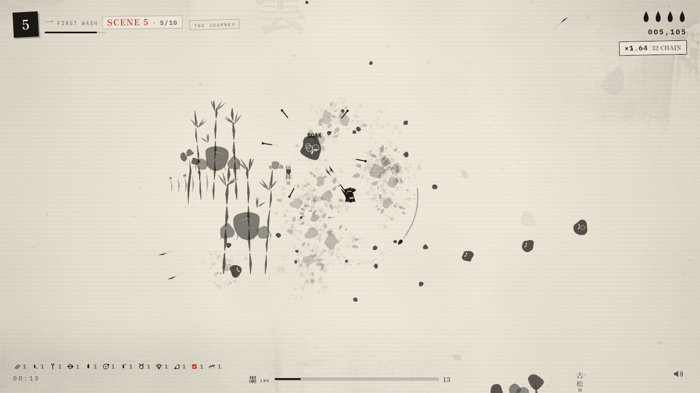 | 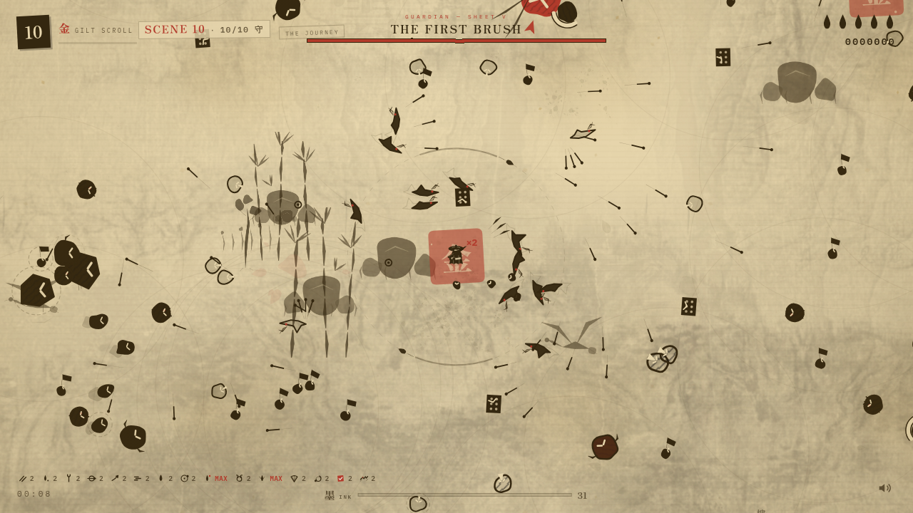 |

| THE SCRIBE on the storm sheet — one living stroke, thirteen squalls circling | CHOOSE ONE MORE — the scribe's own ARTS beside the learned POWERS |
|---|---|
| 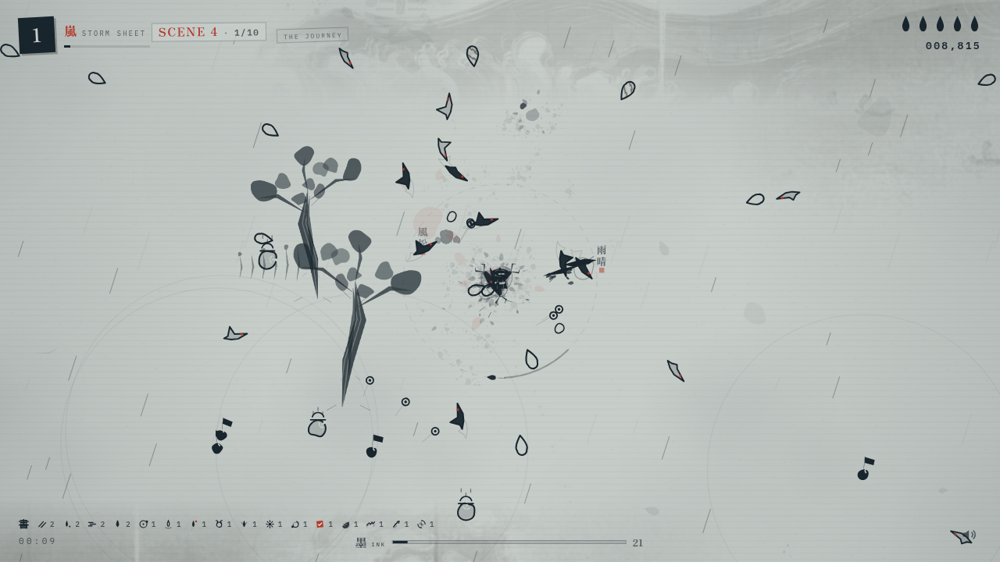 | 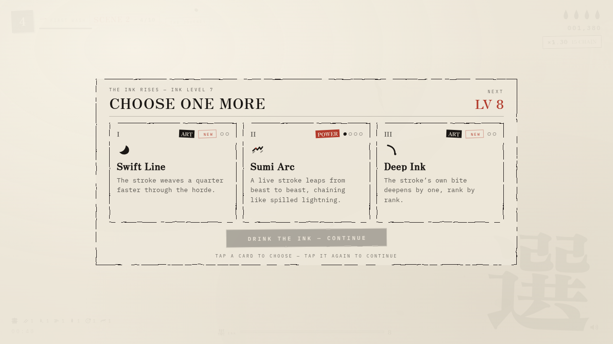 |

| The ink rises — CHOOSE ONE MORE, three cards, two of them weapons | CHARMS — what the runs press out, the paper keeps |
|---|---|
|  | 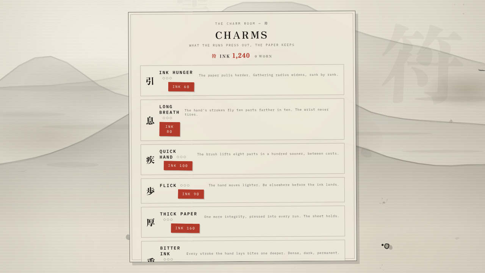 |

---

## The modes

**THE JOURNEY** — the six scrolls, straight onto the wet frontier. The run
resumes where the brush last sealed a scene. Every visit opens with
**THE OPENING** (a short ink cinematic — any key or tap skips it; replay it
from the title's 序 button). When a sheet is cleared **the scroll literally
turns**: the next sheet of paper rolls in over the world, stamps its kanji
and its temperament, and presses its red hanko before the first wave crawls
in. Both films are skippable.

**DAILY INK** — one seeded sheet a day. The same paper, the same beasts, the
same luck for every scribe on Earth; the first sheet you walk today is the
one that counts. A practiced daily presses only a fifth of its ink —
practice is for the hand, not the stone.

**THE ENDLESS SCROLL** — the journey's sixth sheet cleared, the scroll
unbound: no arena, no margins, an endless sheet of washi, and every lap the
beasts stand taller (**hp ×1.24**), think faster (**speed ×1.016**) and
arrive thicker (**budget ×1.32**). Only endless runs post to the ledger —
and waves past the six hundred press **double ink** into the stone.

**REALLY HARD** — the title's red toggle, remembered on this device: beasts
stand ×1.4 taller, arrive ×1.15 faster, waves spend ×1.45 more — and the
ledger pays **double** for every stroke that survives it.

| The six scrolls hang on their wall — seal a scene, wake the next | The starter brush room — three free brushes, four still sealed |
|---|---|
| 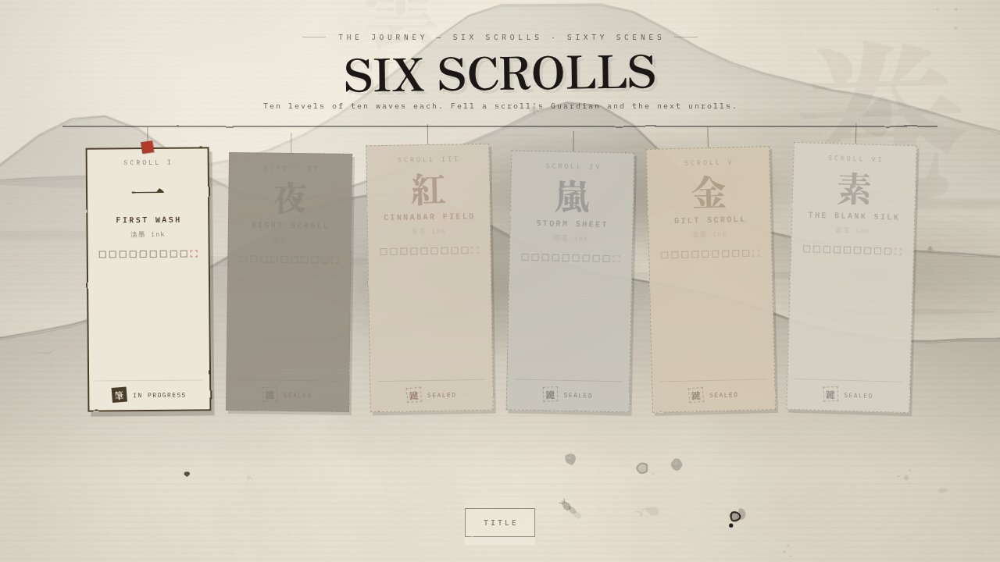 | 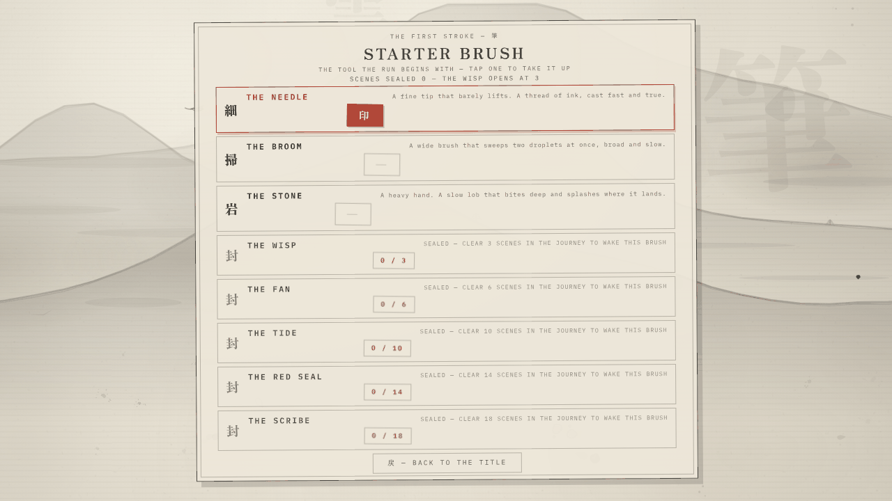 |

<p align="center">
  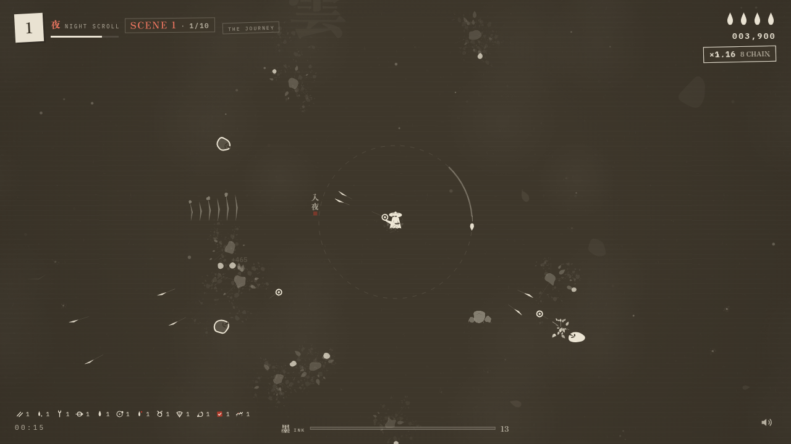
</p>

---

## How a wave breathes

Each scene of ten waves has a shape, and the shape is the rhythm of the
fight:

| Wave | Shape |
|---|---|
| 1 | **opening** — a light trickle, to read the page |
| 2 · 4 · 6 | **press** — the ordinary weight of the sheet |
| 3 | **debut** — the scene's new beast walks in, featured |
| 5 | **SURGE** — a ring closes around the brush |
| 7 | **SEAL HUNT** — elites walk the paper |
| 8 | **FLOOD** — everything, from two sides at once |
| 9 | **SURGE** — the storm before the seal |
| 10 | **SEAL** — an honor guard of elites to break; on scene ten, the **Keeper** — and on scene ten of sheet ten, the **Guardian** itself |

The pressure climbs twice: wave by wave inside a scene, and scene by scene
inside the sheet (scene ten spends ~1.81× the budget of scene one, its
beasts stand ~1.63× taller) — and the sheets themselves climb (**hp ×1 →
×7.9**, **budget ×1 → ×4.1** by the blank silk). Chained kills multiply the
score (decay 2.3 s, ceiling ×5); a hit costs a drop of integrity, and three
drops dry the page.

**Controls**

| Input | Action |
|---|---|
| `W A S D` / arrows | Move — walk anywhere the paper goes |
| auto-fire | Engaged — the brush always flicks at the nearest blot |
| ink motes | Walk over the drops your kills spill; a full gauge = **CHOOSE ONE MORE** |
| `1` `2` `3` | Pick a card — press again, or `Enter`, to drink the ink |
| any key / tap | Skip the opening or any cutscene |
| `P` / `Esc` | Pause |
| `M` | Toggle sound |
| touch | Drag anywhere for a virtual joystick |

---

## The six scrolls

| # | Sheet | Ink | kanji | hp / budget | Captain | Keeper | Special | Guardian |
|---|---|---|---|---|---|---|---|---|
| I | FIRST WASH | 淡墨 pale wash | 一 | ×1.0 / ×1.0 | THE DRUM | THE BLIGHT | — | THE STAIN |
| II | NIGHT SCROLL | 濃墨 lamp-black | 夜 | ×1.7 / ×1.45 | THE CHOIR | THE HUSK | THE NEST | THE NIGHT MOTHER |
| III | CINNABAR FIELD | 朱墨 vermillion | 紅 | ×2.7 / ×2.0 | THE BANNER | THE CINDER | THE MENDER | THE CINNABAR ONI |
| IV | STORM SHEET | 雨墨 rain-grey | 嵐 | ×4.2 / ×2.7 | THE STORMCALLER | THE RAINVEIL | THE TOLLER | THE STORM EYE |
| V | GILT SCROLL | 金墨 gold-dust | 金 | ×6.6 / ×3.4 | THE PAYMASTER | THE NIB | THE LEDGER | THE FIRST BRUSH |
| VI | THE BLANK SILK | 素墨 cool silk | 素 | ×7.9 / ×4.1 | THE HUSH | THE MARGIN | THE TRACE | THE UNWRITTEN |

Journey and daily runs live **inside a fixed arena** — a page with margins,
2240 × 1600 on every screen, so a fight plays the same on a phone as on a
desk. Only THE ENDLESS SCROLL keeps the unbroken sheet.

Every tenth wave of every scene is a **Keeper** fight: a red-sealed beast,
lesser kin of the sheet's Guardian, walking with a halved honor guard — a
debut duel runs twenty-to-thirty honest seconds, and repeats grow with the
scene. Kill it and its seal drops a **chest** (a free stroke of your
choice), a pot of fresh water, and a shower of ink.

**Captains** walk *inside* the pack — never alone, never a boss bar. One cut
from each sheet's own ink, they quicken every beast near them (×1.32 within
210 px), call fresh ink into the paper, and when one falls its whole fan
stuns (1.15 s within 235 px). Walk the wave, find the flag, break the rank.

**Specials** are the paper's odd mechanics, one per sheet from the second
scroll on — breed, mend, toll or tax. Each bends the fight around itself.
Kill them first, or fight the horde they make.

---

## The brushes — ONE BRUSH, ONE BLADE

Choose your brush before the run — the choice is remembered. The brush **is**
the weapon: there is no universal volley hiding behind it, and no weapon ever
arrives the hand did not pick. Three are free; five are sealed behind the
journey's scenes, and a scene **seals** when its tenth wave's Keeper falls.

| Brush | kanji | Sealed until | The weapon it is |
|---|---|---|---|
| THE NEEDLE | 細 | free | casts a thread of ink every 0.30s — fast, light, true |
| THE BROOM | 掃 | free | sweeps two wide droplets at once, broad and slow |
| THE STONE | 岩 | free | lobs a heavy stone — bites 3 deep, splashes where it lands; 4-integrity body |
| THE WISP | 幽 | 3 scenes | breathes homing wisps that lean into the horde — and a spirit wakes beside it |
| THE FAN | 扇 | 6 scenes | a cone of paper blades with every swing; every fifth snaps full-circle |
| THE TIDE | 潮 | 10 scenes | no arrows — a black surge rolls outward every few breaths, and the wet wake you leave still bites |
| THE RED SEAL | 印 | 14 scenes | no arrows — the great hanko falls on the thickest horde, stunning all under it |
| THE SCRIBE | 書 | 18 scenes | the master's way: one living stroke weaves through the horde, perpetual, biting all it passes |

Every brush carries its own **ART track** — techniques no other hand may
learn (see The brush arts). The Wisp, Fan, Tide and Seal brushes are born at
rank 1 of their kindred power; picking that power again deepens it.

---

## The ink-born — 82 of them

Every creature is a living blot of sumi ink with hand-drawn line boil. The
*trait* beside each name is the game's own stamp; **walks in** is the global
wave where the beast debuts, and each scene of each sheet debuts at least
one beast of its own.

**SHEET I · FIRST WASH** — pale ink on fresh washi

| Beast | Trait | Walks in |
|---|---|---|
| **BLOT** | DRIFTER | 1 — slow, relentless |
| **SPEAR** | LUNGER | 11 — telegraphs, then strikes in a straight line |
| **GNAT** | SWARM | 16 — a fast little shard-fleck |
| **POPPER** | BOMBER | 21 — bursts into a ring of needles when it dies |
| **BLOTTER** | SPONGE | 36 — soaks strokes, takes more ink to break |
| **WASHLING** | PALE WANDERER | 31 |
| **MOTH** | ERRATIC | 41 — never holds a course, bursts in jolts |
| **DRIP** | DIVIDER | 51 — dies into two fast blips |
| **RILL** | WEAVER | 51 — a stream that never runs straight, weaving as it closes |
| **PALE CRANE** | SWOOPER | 61 — swoops past in long, fast arcs |
| **BRUTE** | BRUISER | 71 — hatched, dripping, very hard to kill |
| **WISP** | WEAVER | 81 — weaves sideways as it closes in |

**SHEET II · NIGHT SCROLL** — lamp-black on dark paper

| Beast | Trait | Walks in |
|---|---|---|
| **SPIT** | GUNNER | 101 — keeps its distance and lobs ink globs |
| **SHADE** | PHANTOM | 111 — dissolves into flecks, blinks at your back |
| **KAGE** | STALKER | 121 — circles like a stain, then cuts straight through |
| **NIGHTSHADE** | BLINKER | 126 |
| **OWL** | WATCHER | 131 |
| **STILT** | SNIPER | 141 — draws a hair-thin line at you, then fires a needle |
| **LOTUS** | ROOTED | 151 — roots itself and sprays fans of ink at range |
| **SMOTHER** | CREEP | 156 |
| **GLOOM** | BREATH | 156 |
| **WARDEN** | HERALD | 171 — quickens every beast near it. Kill it first |
| **SPECTER** | PHASER | 171 — unhurried, but every few breaths it is suddenly nearer |
| **TITAN** | MOTHER | 181 — sheds her brood as she bears down |

**SHEET III · CINNABAR FIELD** — vermillion-stained ink

| Beast | Trait | Walks in |
|---|---|---|
| **ONI** | CHARGER | 201 — horns down, then bulldozes straight ahead |
| **EMBER** | DASHER | 206 |
| **CRANE** | SWOOPER | 211 |
| **ASHIGARU** | RANK | 211 — marches in file |
| **SEALBEARER** | SEALED | 216 |
| **GATE** | SHIELDED | 221 — frontal strikes are turned; flank it or drown it |
| **STAMPER** | SEALSMITH | 241 |
| **WARHORN** | MUSTER | 281 — its pulse drives every beast near it 32% faster |
| **SHIKI** | SUMMONER | 246 |

**SHEET IV · STORM SHEET** — rain-grey ink

| Beast | Trait | Walks in |
|---|---|---|
| **RAINDRAKE** | CALLER | 301 — the rain answers it |
| **GALE** | GUST | 306 |
| **KOI** | SINEW | 311 — swims long sine curves and *dives beneath your strokes* |
| **SURGE** | BREAKER | 316 |
| **MAELSTROM** | UNDERTOW | 351 — pulls the fight inward |
| **SQUALL** | CIRCLER | 331 — circles the brush, closing its hand |
| **EEL** | RUSHER | 341 — rushes in rivers, fast and never straight |
| **WAVE CREST** | SWELL | 356 |

**SHEET V · GILT SCROLL** — gold-dusted ink

| Beast | Trait | Walks in |
|---|---|---|
| **GILDLING** | GILDED | 401 |
| **PHOENIX** | DIVING | 406 |
| **GOLEM** | COLOSSUS | 411 — a folded colossus that breaks into two brutes |
| **MIRROR** | REFLECT | 421 |
| **KOBAN** | GREED | 436 |
| **GILTWING** | SKIRMISHER | 431 — swoops in; wounded, it flies rich and away |
| **THE MIDAS** | ALCHEMIST | 441 — transmutes lesser beasts into fleeing koban |
| **RELIC CASK** | TREASURY | 441 |

**SHEET VI · THE BLANK SILK** — cool ink on unstained silk

| Beast | Trait | Walks in |
|---|---|---|
| **SKETCH** | UNDRAWN | 501 |
| **STITCH** | SEAM | 511 |
| **RESEAL** | RESTAMPED | 521 |
| **SIZING** | GLUE | 531 |
| **BINDER** | MOUNT | 541 |
| **STENCIL** | STAMPER | 541 — presses red seals where you stand |
| **THE FRAY** | UNRAVELER | 551 — sheds stitchlings from its unraveling seam |
| **WEFT** | LOOM | 551 |

…plus **BLIP** (the shard shed by dividers and mothers), **STITCHLING**
(the shard shed by THE FRAY), the five
**specials** (THE NEST · THE MENDER · THE TOLLER · THE LEDGER · THE TRACE),
the six **Captains**, the six **Keepers** and the six **Guardians** —
eighty-two ink-born in all.

**THE CAPTAINS SURGE (v19).** Every officer now draws a telegraphed road
through the paper every few breaths and takes it — and under its flag the
rank MUSTERS: a swarm of its kindred fans out and hunts the brush, mustering
harder when the officer is wounded. Break the officer and the swarm stands
still.

---

## The six Guardians

Every named beast announces itself with one line — the duel's tone set
before the first stroke lands. Every Guardian is a 35–60 second set piece,
and the First Brush is the longest fight in the game.

| Sheet | Guardian | It speaks |
|---|---|---|
| I · wave 100 | **THE STAIN** | *IT DRINKS THE SHEET. DRINK IT BACK.* |
| II · wave 200 | **THE NIGHT MOTHER** | *THE DARK HAS A HEART. LISTEN TO IT BEAT.* |
| III · wave 300 | **THE CINNABAR ONI** | *FOUR HORNS, ONE ROAD — AND THE ROAD IS BEHIND YOU.* |
| IV · wave 400 | **THE STORM EYE** | *STAND IN THE RAIN. THEN STAND SOMEWHERE ELSE.* |
| V · wave 500 | **THE FIRST BRUSH** | *THE FIRST STROKE IS STILL WET.* |
| VI · wave 600 | **THE UNWRITTEN** | *THE PAGE IS STILL BLANK. IT WANTS YOUR HAND.* |

Its Keeper walks ahead of it every hundred waves: **THE BLIGHT** (*THE STAIN
SENDS ITS FIRST SERVANT* — 10), **THE HUSK** (110), **THE CINDER** (210),
**THE RAINVEIL** (310), **THE NIB** (410), **THE MARGIN** (510).

**The Guardian is the Keeper, upgraded.** Each sheet's finale keeps its
Keeper's whole kit and adds abilities the lesser duel never shows: THE STAIN
slams double rings and calls blotters from phase one; THE NIGHT MOTHER's
brood sheds four wide and an owl rides her shadow; THE CINNABAR ONI's charge
ends in a paper-knockback slam and TWO kin answer its horn; THE STORM EYE
drops six bolts and its own cranes ride the edge; THE FIRST BRUSH opens a
NINE-blade aimed fan and its enraged students come four wide; THE UNWRITTEN
stamps three seals and what it erases comes back RESTAMPED.

---

## The brush arts — 52 picks: strokes, powers, and the brush's own arts

The level-up screen deals three cards from this pool — and the pool answers
the hand: cast-stroke arts only deal to brushes that cast; each brush's own
arts deal only to that brush. **ARTS** (marked 墨-ink on their cards) are the
weapon's own techniques; **POWERS** (marked 武 in vermilion) fight on their
own clocks. Strokes reshape the hand itself.

**The strokes — every hand**

| Stroke | Max | What it does |
|---|---|---|
| Quick Hand | 5 | −15% time between casts |
| Bitter Ink | 4 | every stroke the hand lays bites one deeper |
| Twin Stroke | 3 | +1 stroke per cast (casting brushes only) |
| Through Mist | 3 | cast strokes pass through +1 target (casting brushes only) |
| Flick | 3 | +22% cast-stroke speed (casting brushes only) |
| Fleeting Foot | 4 | +12% movement |
| Thick Ink | 3 | +1 max integrity, restore 1 |
| Red Seal | 3 | every kill presses a seal — a short 1.2× stride surge |
| Ink Burst | 1 | taking a hit splashes everything nearby away |
| Echo Stroke | 2 | a mirrored cast answers behind your back (casting brushes only) |
| Ink Orbit | 3 | droplets circle the brush in a wide ring |
| Wet Paper | 2 | struck beasts wade — slowed briefly |
| Crimson Tip | 2 | one stroke in six bites twice as deep |
| Paper Ward | 1 | a dry talisman swallows one hit whole, then reforms |
| Ink Hunger | 3 | +42% gathering radius per rank |
| Paper Mends | 2 | the sheet heals itself, +1 integrity every so often |
| Deep Well | 2 | every mote is worth +25% more |

**The learned powers — any hand; the born brush starts at rank 1**

| Power | Max | At its peak it becomes |
|---|---|---|
| Black Tide | 3 | the surge comes faster and reaches farther |
| Folded Fan | 4 | more blades every swing — the fan's own bloom |
| Spirit Scribes | 3 | **THE LITANY** — spirits run through up to three bodies |
| Crimson Hanko | 3 | **THE TWIN STAMP** — a second, lighter seal follows the first |
| Ink Trail | 3 | **THE LINGERING POOL** — the ink bites twice as fast, pools deeper |
| Sumi Arc | 4 | **THE LIVING LINE** — the stroke leaps three links farther |
| Returning Stroke | 4 | **THE MIRROR RETURN** — the homing stroke bursts into an ink ring |
| Ink Vortex | 3 | **THE WHORL TEETH** — the closing whirlpool bites what remains |

**The brush's own arts — one track, one hand (v19)**

| Brush | Art | Max | What it does |
|---|---|---|---|
| NEEDLE | Needle Rain | 1 | every sixth cast opens into a six-thread fan |
| NEEDLE | Deep Point | 2 | the thread bites one deeper |
| NEEDLE | Silk Thread | 2 | the thread flies a fifth farther |
| BROOM | Wide Sweep | 2 | the sweep opens wider; rank two adds a third droplet |
| BROOM | Heavy Bristles | 2 | the broom's droplets bite one deeper |
| BROOM | Wet Sweep | 1 | what the sweep touches wades — slowed |
| STONE | Shatter | 2 | the splash reaches nearly half again |
| STONE | Quake | 1 | the splash stuns a breath |
| STONE | Boulder | 2 | the lob bites deeper and flies faster |
| WISP | Twin Wisps | 2 | a second, then a third wisp with every cast |
| WISP | Swift Haunt | 2 | faster casts, tighter turns |
| FAN | Full Bloom | 1 | every FOURTH swing snaps full-circle |
| FAN | Gale Push | 1 | blades knock the horde back as they cut |
| FAN | Edge Wind | 2 | one more blade rides every swing |
| TIDE | Riptide | 2 | the surge shoves harder and stuns longer |
| TIDE | Deep Swell | 2 | the surge's own bite deepens |
| TIDE | Undertow | 1 | the wet wake bites twice as fast |
| TIDE | Spring Tide | 2 | the surge reaches a fifth farther |
| SEAL | Twin Stamp | 1 | a second, lighter seal follows the first |
| SEAL | Broad Seal | 2 | the stamp presses a quarter broader |
| SEAL | Deep Press | 2 | the stamp's own bite deepens |
| SEAL | Red Rain | 1 | every fifth stamp falls twice — two hordes both |
| SCRIBE | Second Scribe | 2 | another living stroke wakes |
| SCRIBE | Swift Line | 2 | the stroke weaves a quarter faster |
| SCRIBE | Long Stroke | 2 | the stroke grows — all it passes feels its width |
| SCRIBE | Ink Wake | 1 | where the stroke passed, its ink lingers and bites |
| SCRIBE | Deep Ink | 2 | the stroke's own bite deepens |

Found on the paper: the **pot** (+1 integrity), the **墨 talisman** (vacuums
every mote), the **ink bomb** (splashes the whole sheet), and the Keepers'
**chest** — a free stroke of your choice.

---

## Charms (符) — what the inkstone buys

Permanent upgrades pressed between runs. A charm's rank rides every page the
hand opens — journey, endless, daily, the resumed frontier. Twelve charms over
**32 ranks; the whole board costs 硯 15,820** — a full victory run presses
about 3,700, so the deep ranks are bought with real journeys. The ladder is
shaped honestly: the cheapest charm lands on the first run, quality-of-life
leads, damage is capped at half a real build, and the Paper Ward charm retires
the in-run pick so there are no trap options.

| Charm | kanji | Ranks | Cost (ink) | What it presses |
|---|---|---|---|---|
| INK HUNGER | 引 | 3 | 60 · 150 · 380 | gathering radius widens, rank by rank |
| LONG BREATH | 息 | 3 | 80 · 200 · 500 | the hand's strokes fly 10% farther per rank |
| FLICK | 歩 | 3 | 90 · 230 · 560 | the hand moves 8% lighter per rank |
| QUICK HAND | 疾 | 3 | 100 · 260 · 640 | the brush lifts 8% faster per rank |
| THICK PAPER | 厚 | 3 | 160 · 420 · 960 | one more integrity, pressed into every run |
| RED TIP | 赤 | 3 | 180 · 460 · 1050 | six strokes in a hundred bite twice as deep |
| BITTER INK | 重 | 3 | 190 · 500 · 1250 | every stroke the hand lays bites one deeper |
| THE OLD INK | 遺 | 3 | 300 · 700 · 1500 | every mote is worth a fourth more |
| THE PAPER WARD | 守 | 1 | 560 | every run begins warded |
| **THE FIRST STROKE** | 筆 | 3 | 260 · 620 · 1400 | the brush you carry bites one deeper — its own ink only |
| **THE SWIFT HAND** | 手 | 2 | 240 · 580 | the brush you carry casts 10% sooner per rank |
| **THE SCHOLAR** | 学 | 2 | 380 · 860 | every wave survived presses 10% deeper into the stone |

### The Inkstone (硯) — the idle page

Every run ends with the press: the ink is squeezed back into the stone. A
currency that survives the paper.

| The ledger, fed by the debug cloud — three eyes: ALL-TIME, DAILY, WEEKLY | The stone remembers — 2,140 ink held, 3,180 pressed, a journal of feats |
|---|---|
| 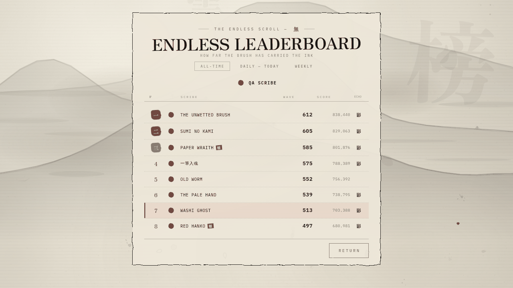 | 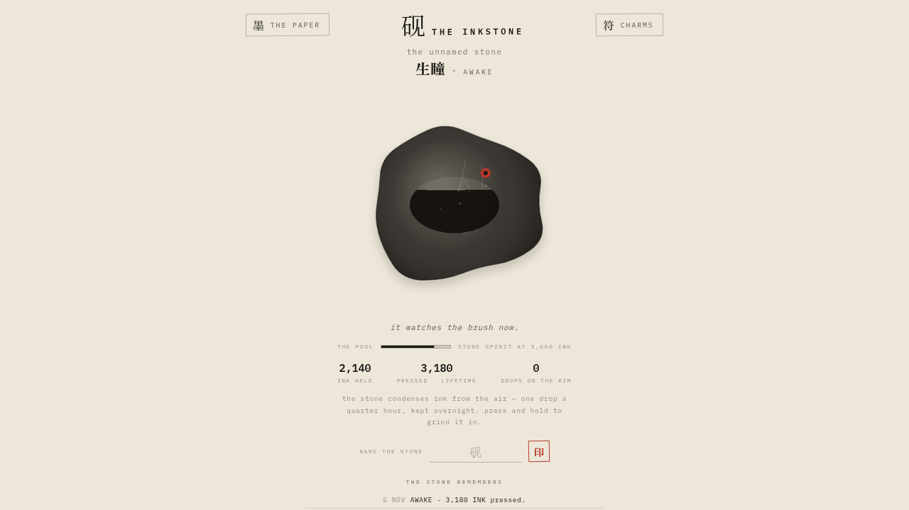 |

**What a run presses**: 6 ink per wave survived — waves past the six hundred
press **double**; +80 per Guardian felled; +300 once ever for the six sheets
signed; a new personal best presses ×1.25; REALLY HARD presses the ledger's
own ×2; a practiced daily only a fifth.

**Between runs, the stone lives its own life** (`inkstone.html`): it
condenses ink from the air — one drop a quarter hour, kept overnight — it
grows through named stages as the pool deepens (頑石 rough stone → 生暉 awake
→ …), you can seal a name onto it, and **THE STONE REMEMBERS** — a journal
of everything pressed. Grind it by hand: press and hold.

**The run's report** can be pressed into a share card — 1080 × 1350, stamped
with the run's hanko (or your ledger rank, #N, when a post landed), ready to
carry the fight to the world.

**Ranks** are waves cleared, printed as the end-of-run seal:
**C** 70 · **B** 190 · **A** 300 · **S** 400 · **S+** 500.

---

## The endless leaderboard (榜) on Supabase

The **ENDLESS LEADERBOARD** records the furthest wave every scribe has
carried the ink in **THE ENDLESS SCROLL**. It runs on **Supabase**'s free
tier: a Postgres ledger, row-level security as the lock, and
**sign-the-page identity** — the scribe signs in from the settings room
(印 — THE SCRIBE'S MARK): Google is the door, an anonymous mark the quiet
second, and the name you stamp there is the name the board wears (the email
stays home — it never reaches the ledger). Until it is connected the game
plays exactly as before — the ledger sits quietly offline.

**How it behaves when connected**

- Endless runs post automatically on death — but only if the run carried
  further than your best on this device (one page per scribe, no spam).
- Died without signing? The over sheet offers **SIGN IN FROM SETTINGS —
  THE RUN POSTS ITSELF**: the run waits while you sign (the trip to Google
  and back included), and posts the moment the sign lands.
- Your mark lives in the settings room: **STAMP** a custom name and it
  travels — even onto the pages already written — so no email tag ever
  shows on the board. Sign out there too.
- Every endless run also raises your **WEEKLY** page — your best run of the
  ISO week, one page per scribe a week. The board wears three eyes:
  ALL-TIME, DAILY, WEEKLY.
- Pages carry their scribe's **echo** — the recorded strokes of the run
  that set them. A row bearing 影 downloads that recording when pressed:
  **RACE THIS ECHO** arms a stranger's echo, closes the board, and starts a
  run with their pale ink walking beside yours (a daily echo races the
  day's own seeded sheet). The over sheet names them in the verdict, and
  the 設 room's 影 toggle still silences every echo at once.
- Rank = the wave you reached; score breaks ties. Top three wear red hanko
  seals. Your own row is edged in vermillion. When a post lands, the share
  card's hanko stamps your **ledger rank** (#N) instead of the run's seal
  rank.
- The journey's own deaths never post — the ledger belongs to the endless
  scroll alone (a journey victory that walks INTO THE ENDLESS posts from
  then on, carrying the whole run's depth).

**One-time setup (about five minutes)**

1. Create a project at [supabase.com](https://supabase.com) — the free
   tier is plenty for a board of scribes.
2. **SQL Editor → New query** → paste the SQL below **→ Run**.
3. **Project Settings → API** → copy the **Project URL** and the **anon
   public key** into `js/supabase-config.js`.
4. **Authentication → Sign In / Up → Google → Enable** — create the
   OAuth client at [console.cloud.google.com](https://console.cloud.google.com)
   (Web application, authorized redirect
   `https://<your-project>.supabase.co/auth/v1/callback`), paste its ID
   and secret, and add your GitHub Pages domain under
   **Authentication → URL Configuration → Redirect URLs**.
5. **Authentication → URL Configuration → Site URL** — set it to your
   GitHub Pages address (`https://<your-username>.github.io/<repo>/`).
6. Optional, the quiet second door: **Anonymous sign-ins → Enable →
   Save** — players who skip Google can still ink an anonymous mark
   (this device only) from the same settings room.

The free tier is generous (the anon key is rate-limited by a fair-use
quota, far beyond what a board of honest scribes spends); this ledger
costs a read when the board opens and a write only when a scribe beats
their own best.

**The ledger's SQL** — three tables, one page per scribe, checks that cap
any damage a mischievous brush could try. Paste all of it:

```sql
-- ONE MORE — the endless ledger (榜)

create table if not exists om_scores (
  uid   uuid primary key references auth.users(id) on delete cascade,
  name  text    not null default 'INK DRIFTER' check (char_length(name) between 1 and 24),
  wave  integer not null check (wave between 1 and 99999),
  score integer not null default 0 check (score between 0 and 999999999),
  kills integer not null default 0 check (kills between 0 and 999999),
  time  integer not null default 0 check (time >= 0),
  hard  boolean not null default false,
  ghost text,
  has_ghost boolean not null default false,
  v     integer not null default 1,
  ts    timestamptz not null default now()
);

create table if not exists om_daily (
  day   text    not null check (day ~ '^[0-9]{4}-[0-9]{2}-[0-9]{2}$'),
  uid   uuid    not null references auth.users(id) on delete cascade,
  name  text    not null default 'INK DRIFTER' check (char_length(name) between 1 and 24),
  wave  integer not null check (wave between 1 and 99999),
  score integer not null default 0 check (score between 0 and 999999999),
  kills integer not null default 0 check (kills between 0 and 999999),
  hard  boolean not null default false,
  ghost text,
  has_ghost boolean not null default false,
  v     integer not null default 1,
  ts    timestamptz not null default now(),
  primary key (day, uid)
);

create table if not exists om_weekly (
  week  text    not null check (week ~ '^[0-9]{4}-W[0-9]{2}$'),
  uid   uuid    not null references auth.users(id) on delete cascade,
  name  text    not null default 'INK DRIFTER' check (char_length(name) between 1 and 24),
  wave  integer not null check (wave between 1 and 99999),
  score integer not null default 0 check (score between 0 and 999999999),
  kills integer not null default 0 check (kills between 0 and 999999),
  hard  boolean not null default false,
  ghost text,
  has_ghost boolean not null default false,
  v     integer not null default 1,
  ts    timestamptz not null default now(),
  primary key (week, uid)
);

create index if not exists om_scores_wave_idx on om_scores (wave desc, score desc);
create index if not exists om_daily_day_idx  on om_daily (day, score desc);
create index if not exists om_weekly_week_idx on om_weekly (week, score desc);

alter table om_scores enable row level security;
alter table om_daily  enable row level security;
alter table om_weekly enable row level security;

-- the world may read; only the signed scribe may raise their own page
create policy "the board is public" on om_scores
  for select using (true);
create policy "a scribe signs only their page" on om_scores
  for insert with check (auth.uid() = uid);
create policy "a scribe raises only their page" on om_scores
  for update using (auth.uid() = uid) with check (auth.uid() = uid);

create policy "the day is public" on om_daily
  for select using (true);
create policy "a scribe signs only their day" on om_daily
  for insert with check (auth.uid() = uid);
create policy "a scribe raises only their day" on om_daily
  for update using (auth.uid() = uid) with check (auth.uid() = uid);

create policy "the week is public" on om_weekly
  for select using (true);
create policy "a scribe signs only their week" on om_weekly
  for insert with check (auth.uid() = uid);
create policy "a scribe raises only their week" on om_weekly
  for update using (auth.uid() = uid) with check (auth.uid() = uid);
```

> Already running the earlier two-table ledger? Paste this once and the
> echo columns, the weekly page and the board's third eye land in place.
> Safe to re-run:
>
> ```sql
> alter table om_scores add column if not exists ghost text;
> alter table om_scores add column if not exists has_ghost boolean not null default false;
> alter table om_daily  add column if not exists ghost text;
> alter table om_daily  add column if not exists has_ghost boolean not null default false;
>
> create table if not exists om_weekly (
>   week  text    not null check (week ~ '^[0-9]{4}-W[0-9]{2}$'),
>   uid   uuid    not null references auth.users(id) on delete cascade,
>   name  text    not null default 'INK DRIFTER' check (char_length(name) between 1 and 24),
>   wave  integer not null check (wave between 1 and 99999),
>   score integer not null default 0 check (score between 0 and 999999999),
>   kills integer not null default 0 check (kills between 0 and 999999),
>   hard  boolean not null default false,
>   ghost text,
>   has_ghost boolean not null default false,
>   v     integer not null default 1,
>   ts    timestamptz not null default now(),
>   primary key (week, uid)
> );
> create index if not exists om_weekly_week_idx on om_weekly (week, score desc);
> alter table om_weekly enable row level security;
> drop policy if exists "the week is public" on om_weekly;
> create policy "the week is public" on om_weekly for select using (true);
> drop policy if exists "a scribe signs only their week" on om_weekly;
> create policy "a scribe signs only their week" on om_weekly
>   for insert with check (auth.uid() = uid);
> drop policy if exists "a scribe raises only their week" on om_weekly;
> create policy "a scribe raises only their week" on om_weekly
>   for update using (auth.uid() = uid) with check (auth.uid() = uid);
> ```

> A client-only leaderboard can be poked by a determined hand — the
> SQL above caps the damage (sane ranges, one page per signed scribe,
> no deletes, RLS refusing every page but one's own, echo blobs capped
> by the recorder itself at ~28 minutes of strokes). That is the
> right weight for a brush-and-paper arcade board.

---

## Deploy to GitHub Pages

The repo ships with a ready-made workflow at
`.github/workflows/deploy.yml` that publishes the site on every push to
`main` using the official GitHub Pages Actions pipeline.

1. Create a new repository on GitHub (e.g. `one-more`).
2. Push this folder's contents to the `main` branch:

   ```bash
   git init
   git add -A
   git commit -m "ONE MORE — the scroll turns"
   git branch -M main
   git remote add origin https://github.com/<your-username>/one-more.git
   git push -u origin main
   ```

3. In the repository, go to **Settings → Pages** and set
   **Build and deployment → Source** to **GitHub Actions**.
4. That's it. The workflow runs on every push and publishes the game to:

   `https://<your-username>.github.io/one-more/`

You can also trigger a redeploy manually from the **Actions** tab via
**Run workflow** (the workflow has `workflow_dispatch` enabled).

> Note: the first deploy requires step 3. If the workflow fails with a
> "Pages not enabled" error, this is the setting you missed.

## Run locally

No build step. Any static server works:

```bash
python3 -m http.server 8000
# then open http://localhost:8000
```

(Opening `index.html` directly from disk also works.)

## Install as an app (PWA) · 端

ONE MORE is a full PWA — installable and fully offline. Visit the site in
Chrome, Edge or Safari and choose **Install app** / **Add to Home Screen**:
the game opens standalone with no browser chrome, stamped with its own
hanko icon, and plays entirely offline.

<p align="center">
  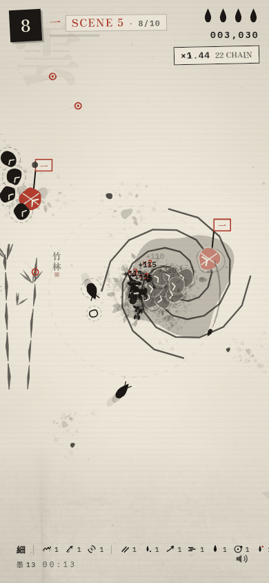
</p>

**Updates are automatic.** The service worker (`sw.js`) precaches the shell
and every ink asset on first visit and sweeps images into a runtime cache as
they are first painted; page navigations go network-first with the cached
shell as the offline fall. On every online visit the browser byte-checks
`sw.js` — a version bump (`om-core-vX.Y`) installs the new worker in the
background, `skipWaiting` activates it immediately, `clients.claim` takes
the open page, and the activate step retires every cache that does not carry
the current version. In practice: **deploy, and the next time the player
opens or reloads the game, the new build is already on their paper.** The
one discipline: bump `VER` in `sw.js` on every build. All paths are
scope-relative, so it works identically at a user-site root or a project
subpath on GitHub Pages.

## Project structure

```
one-more/
├── index.html                  # shell: canvas + all screens + ink wobble filters
├── inkstone.html               # THE INKSTONE — the idle page (the stone the runs press)
├── css/
│   ├── style.css               # the sumi-e design system
│   └── inkstone.css            # the stone page's paper
├── js/
│   ├── config.js               # tuning: sheets, beasts, waves, xp, upgrades, charms
│   ├── audio.js                # synthesized ink sound kit (splats, taiko, gong, thunder)
│   ├── ui.js                   # DOM screens, HUD, ink gauge, boss seal, brush picker
│   ├── game.js                 # run state, waves, arenas, guardians, weapons, economy
│   ├── render.js               # sumi-e renderer: six papers, weather, line boil, stains
│   ├── charms.js               # the charm ladder (符) — ranks, costs, application
│   ├── inkstone.js             # the idle stone: condensation, stages, journal
│   ├── share.js                # the 1080×1350 share card
│   ├── cutscene.js             # scroll-turn interludes & the journey's-end finale
│   ├── intro.js                # THE OPENING — the skippable ink cinematic
│   ├── lb.js                   # the endless ledger: sign-the-page + Postgres board
│   ├── supabase-config.js      # the ink cloud's address (paste your URL + anon key)
│   └── main.js                 # bootstrap, input, hit-stop game loop, wiring
├── screenshots/                # the paper in pictures (used by this README)
├── .github/workflows/deploy.yml # GitHub Pages deployment
├── .nojekyll                   # serve files as-is, skip Jekyll
├── manifest.json               # the PWA manifest
├── sw.js                       # the service worker — versioned caches, offline
├── LICENSE
└── README.md
```

## Tuning the scrolls

Everything is a knob in `js/config.js` — edit and refresh, no build:

- `AREAS` — the six sheets: ink, paper theme, multipliers, debut order,
  scene names, roster, elite / Keeper / Guardian
- `ENEMIES` + `ENEMY_WEIGHTS` — hp, speed, size, cost, score, debut wave,
  spawn weight for all seventy-two
- `CFG.wave` — the ten-wave shape: budgets, surge cadence, elite scaling,
  the concurrent cap (150) and group size
- `CFG.xp` / `CFG.combo` — the mote economy and the chain multiplier
- `CFG.brushes` — the eight brushes and their weapon bodies (`atk`)
- `UPGRADES` — the 25 picks, their caps, and the eight max-tier specials
- `CHARMS` — the nine charms, their ranks and ink costs
- `CFG.charmEarn` — what a run presses into the stone
- `CFG.endless` / `CFG.hard` — the two teeth: lap growth and REALLY HARD
- `CFG.world` — the fixed arena (2240 × 1600), spawn padding, stain cap
- `CFG.ranks` — the end-of-run seal thresholds

High score, run counter, brush choice, charms, the stone and mute
preference persist in `localStorage` — no accounts, no tracking. GitHub
Pages serves static files only, and the game is 100% client-side by
design.

### QA hooks (hidden)

For testing deep sheets, the Guardians and the ending without a full run —
a URL that asks questions is QA: it lands on the title with the next run
armed.

| Param | What it does |
|---|---|
| `?wave=N` | start the next run at global wave N (0–999) — `?wave=500` drops the run on the First Brush |
| `&power=N` | seed a deep-run build of N upgrades (0–30; 60% stats, 40% powers) |
| `&god=1` | the scribe cannot bleed — for probes that must outlive a swarm |
| `&hard=1` | force REALLY HARD for the run |
| `?daily=1` | walk today's seeded sheet |
| `&day=YYYY-MM-DD` | a specific day's sheet |
| `?charms=N` | seed the stone with N ink |
| `?scenes=N` | probe the sealed-brush gate (0–60 scenes sealed) |
| `?lbdebug=1` | the ledger's paper cloud — twelve fake scribes to E2E the board |
| `?fps=1` | the frame-rate stamp |
| `?nores` | disable the adaptive resolution scaler |

Example: `index.html?wave=500&power=30&god=1`, then press THE JOURNEY.

## Tech

- Vanilla JavaScript (ES6+), Canvas 2D, WebAudio API — zero dependencies,
  zero build step, zero telemetry
- Procedural brush rendering: tapered strokes, wobbling blobs, splatter
  stamps, dry-brush streaks, line-boil animation at 0.115 s per
  hand-drawn frame — no image assets for the creatures
- A world that remembers: sprite-cached world-space stains dry into the
  paper (430 kept, fading), hash-grid ambient marks, per-sheet weather —
  motes, embers, petals, driving rain with lightning, drifting gold leaf
- The fixed arena for journey/daily (2240 × 1600, camera-clamped, the
  border on screen) and the truly unbounded endless sheet
- An FX budget: 900 live flecks, thinned over the soft cap, oldest
  recycled past the hard cap — a flood never buries the frame
- The ink engine also paints the films: THE OPENING (drop physics, the
  paper flood, calligraphic strokes, the slamming seal), the scroll-turn
  interludes, and the journey's-end finale (credits, the closing ensō) —
  all skippable, reduced-motion aware
- The meta paper: charms, the idle inkstone with its condensation clock
  and journal, the share card, ghost echoes that walk beside you
- Full PWA: web manifest + service worker — installable, offline-capable,
  versioned caches, hanko icon set (32/180/192/512, any + maskable)
- Fonts: Zen Antique, IBM Plex Mono (Google Fonts CDN, with system
  fallbacks if offline)

## License

MIT — see [LICENSE](./LICENSE).
