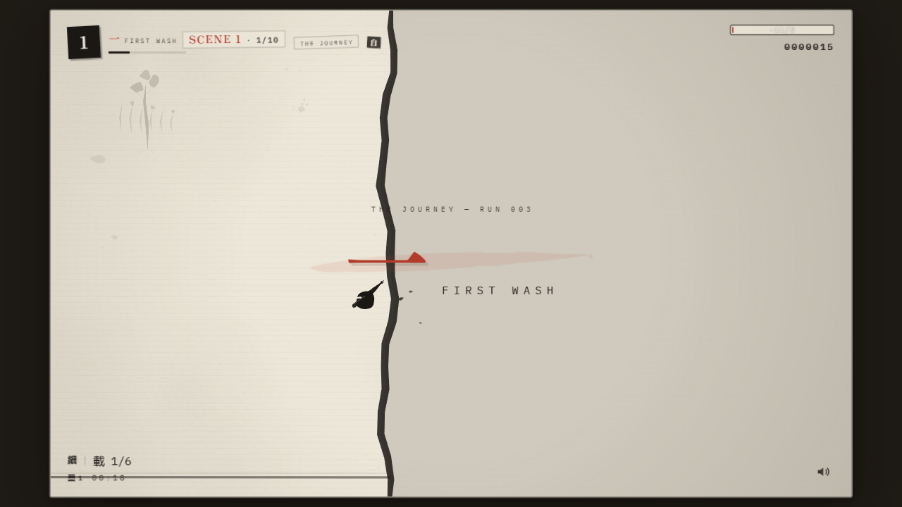
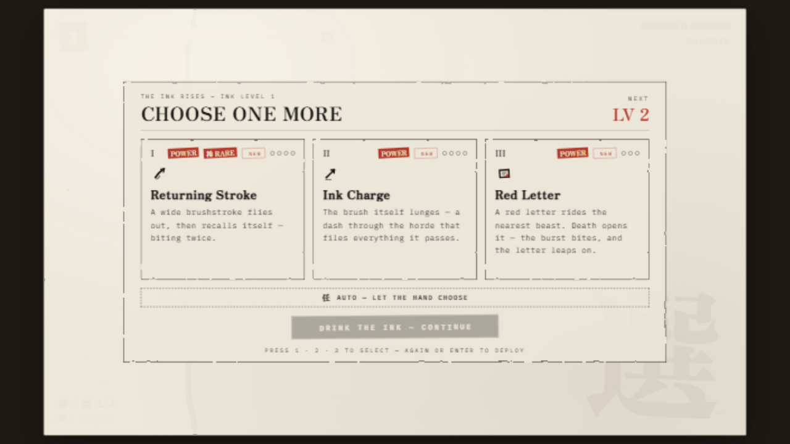
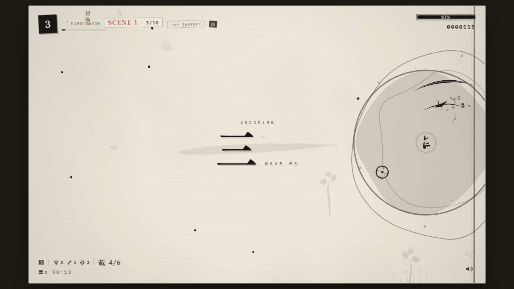
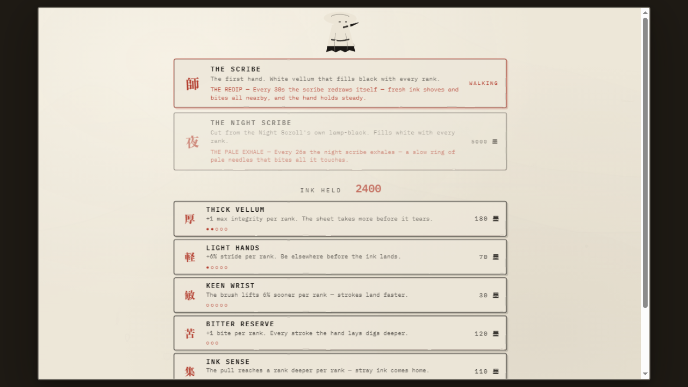
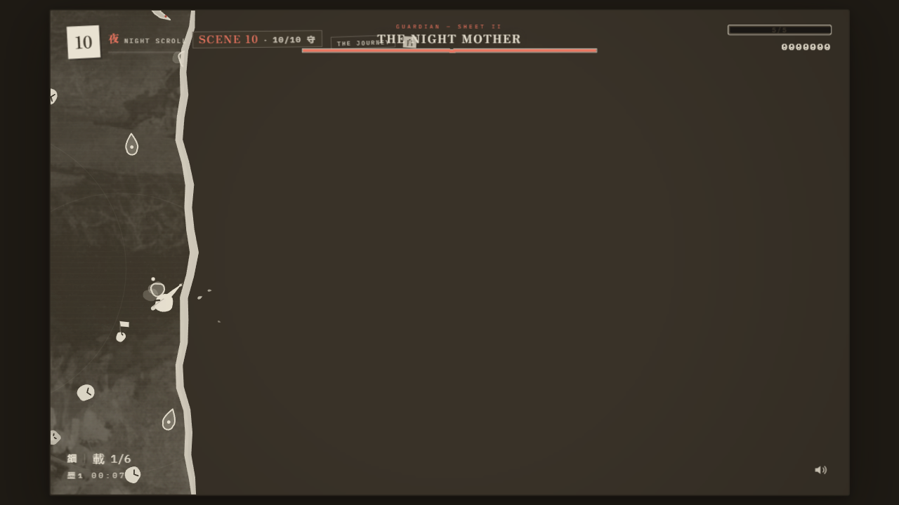
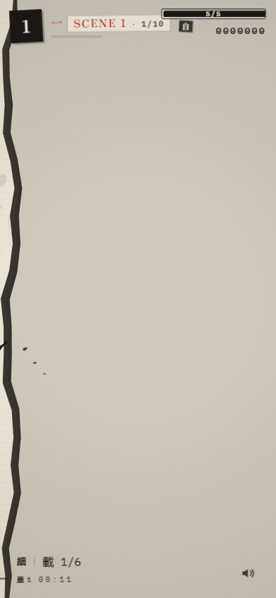
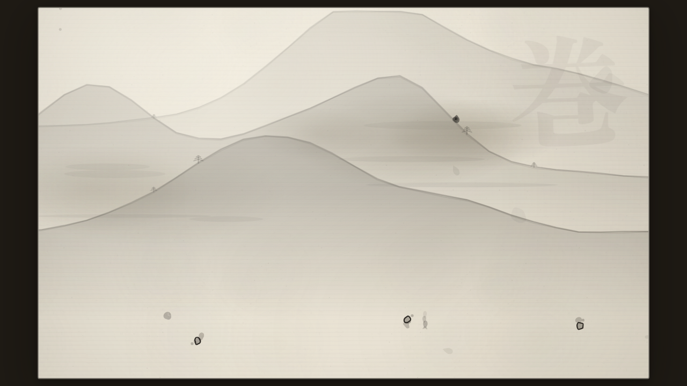
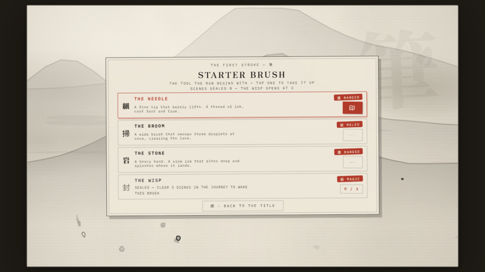
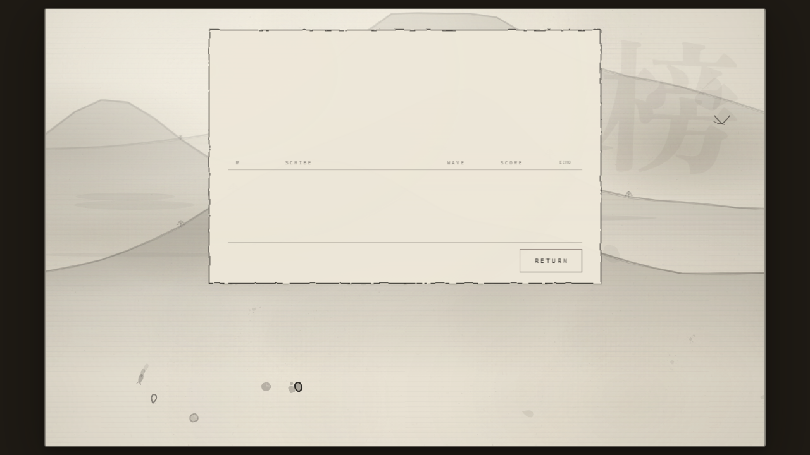

<h1 align="center">ONE MORE</h1>

<p align="center">
  <i>An ink-born survival. One brush. Two scrolls. The paper never ends.</i>
</p>

<p align="center">
  
</p>

<p align="center">
  vanilla JS · Canvas 2D · zero dependencies · zero build · full PWA · MIT
</p>

---

**ONE MORE** is a Vampire-Survivors-like painted as living sumi-e, written in
vanilla HTML/CSS/JS. You are a brush spirit walking sheets of washi paper;
your brush **is** your weapon — choose one of four starters and the run begins
with that arm and nothing else: the needle's thread (ranged), the broom's sweep
(melee), the stone's lob (ranged), or the wisp's homing breath (magic). Every
brush carries its class, and the level-up shelf **pulls your own class
five-deep** — a needle run meets ranged arms way more often, without ever
closing the door on the rest. Your only job is to *not be erased*.

Every kill spills ink motes — gather them to fill the ensō ring around the
brush and rise mid-battle. Every kill also splatters real ink that
**permanently stains the paper**: by the second sheet the world is a painting
of your whole fight. And every run leaves more than stains — it gathers **墨**,
the ink that feeds **THE STUDY**, where the hand itself is sharpened between
runs.

The journey is **two scrolls of ten scenes**, each scene ten waves — two
hundred waves on the way to the last Guardian. Clear the second sheet and
**THE JOURNEY'S END** plays — the ink stills, the keepers are remembered, your
brush paints one last great ensō around the run and seals it — and the scroll
offers itself forever: **THE ENDLESS SCROLL**, where the paper cycles **all six
papers** and the difficulty never stops compounding.

Everything here is honest, hand-tuned and local: no engine, no framework,
no telemetry. The one cloud in the room — the endless leaderboard — is
optional and can stay dark forever.

---

## The paper in pictures

| The sheet lives on the desk — framed, centered, the title beneath the ensō | The journey — beasts circle, the dead stain the paper, the HUD wears the wave seal |
|---|---|
|  |  |

| CHOOSE ONE MORE — the shelf: a 稀 RARE arm, the melee lunge, the red curse | THE MELEE LAW — the fan's swing, the whirl wheel and the orbit pool, no projectiles |
|---|---|
|  |  |

| THE STUDY — two scribes, six skills, the ink every run leaves behind | THE NIGHT MOTHER — a Guardian duel on the lamp-black sheet |
|---|---|
|  |  |

---

## The modes

**THE JOURNEY** — the two scrolls, straight onto the wet frontier. The run
resumes where the brush last sealed a scene. Every visit opens with
**THE OPENING** (a short ink cinematic — any key or tap skips it; replay it
from the title's 序 button). When a sheet is cleared **the scroll literally
turns**: the next sheet of paper rolls in over the world, stamps its kanji
and its temperament, and presses its red hanko before the first wave crawls
in. Both films are skippable.

**DAILY INK** — one seeded sheet a day. The same paper, the same beasts, the
same luck for every scribe on Earth; the first sheet you walk today is the
one that counts. A practiced daily presses only a fifth of its ink —
practice is for the hand, not the stone.

**THE ENDLESS SCROLL** — the journey's second sheet cleared, the scroll
unbound: an endless sheet of washi that cycles **all six papers**, and every
lap the beasts stand taller (**hp ×1.24**), think faster (**speed ×1.016**)
and arrive thicker (**budget ×1.32**). Only endless runs post to the ledger.

**REALLY HARD** — the settings' red toggle (設 — remembered on this device): beasts
stand ×1.4 taller, arrive ×1.15 faster, waves spend ×1.45 more — and the
ledger pays **double** for every stroke that survives it.

**自 THE AUTOBRUSH** — available from the first sheet (the settings' toggle, no
unlock): the brush walks itself, dodging, chasing ink and feeding itself
shots. Any real input outranks it instantly, and its runs press **half** the
score and half the ink — an honest walker, not a cheat.

<p align="center">
  
</p>

The sheet itself is a **framed paper on a dark desk** on desktop — centered,
bordered, shadowed — and every screen lives inside it. Phones keep the
full-bleed sheet.

---

## How a wave breathes

Each scene of ten waves has a shape, and the shape is the rhythm of the
fight:

| Wave | Shape |
|---|---|
| 1 | **opening** — a light trickle, to read the page |
| 2 · 4 · 6 | **press** — the ordinary weight of the sheet |
| 3 | **debut** — the scene's new beast walks in, featured |
| 5 | **SURGE** — a ring closes around the brush |
| 7 | **SEAL HUNT** — elites walk the paper |
| 8 | **FLOOD** — everything, from two sides at once |
| 9 | **SURGE** — the storm before the seal |
| 10 | **SEAL** — an honor guard of elites to break; on scene ten, the **Keeper** — and on scene ten of sheet ten, the **Guardian** itself |

The pressure climbs twice: wave by wave inside a scene, and scene by scene
inside the sheet — and the sheets themselves climb. Chained kills multiply the
score (ceiling ×5); a hit costs a drop of integrity, and the last drop dries
the page.

**Controls**

| Input | Action |
|---|---|
| `W A S D` / arrows | Move — walk anywhere the paper goes |
| auto-fire | Engaged — the brush always flicks at the nearest blot |
| 自 THE AUTOBRUSH | the settings' toggle — **available from the first sheet**: the brush walks itself; any real input outranks it |
| ink motes | Walk over the drops your kills spill — the ensō ring around the brush fills, and closing it means **CHOOSE ONE MORE** |
| `1` `2` `3` | Pick a card — press again, or `Enter`, to drink the ink |
| any key / tap | Skip the opening or any cutscene |
| `P` / `Esc` | Pause |
| `M` | Toggle sound |
| touch | Drag anywhere for a virtual joystick |

---

## The two scrolls

| # | Sheet | Ink | kanji | Captain | Keeper | Special | Guardian |
|---|---|---|---|---|---|---|---|
| I | FIRST WASH | 淡墨 pale wash | 一 | THE DRUM | THE BLIGHT | — | THE STAIN |
| II | NIGHT SCROLL | 濃墨 lamp-black | 夜 | THE CHOIR | THE HUSK | THE NEST | THE NIGHT MOTHER |

<p align="center">
  
</p>

Journey and daily runs live **inside a fixed arena** — a page with margins,
so a fight plays the same on a phone as on a desk. The endless scroll keeps
the unbroken sheet.

Every tenth wave of every scene is a **Keeper** fight — and **every scene owns
its own**: twenty red-sealed bosses, ten to a sheet, each with its own body,
its own cry, and its own abilities cut from a kit of primitives — radial
slams, aimed needle fans, volleys, broods, mirrors, telegraphed charges,
blinks, red seal-stamps, sky-rain, spirals, orbits, musters. Since v20 the
whole boss class wears **one ink**: the paper's sacred vermillion (brightened
on the night scroll so it burns there too) — Guardian, Keeper and Captain are
one red family, and the horde stays the sheet's own black ink. THE POOL
spreads and breeds gnats; THE FAR PEAK breaks its own road through the paper;
THE PAPER LANTERN circles at a spear's length; THE GILD MOTHER counts her
half-ink copies. Kill a Keeper and its seal drops a flush of ink — the scene's
true Keeper (scene ten) also drops a **chest** (a free stroke of your choice)
and a pot of fresh water.

**THE ASSEMBLY** — scene ten's tenth wave. The Guardian enters alone, and the
sheet comes with it: at 72%, 45% and 20% of the Guardian's ink, the scene
bosses return as **echoes** (a third of their ink, kit and color intact) —
three, three, then four, until the arena holds **all ten seals and the
Guardian at once**. The Guardian's fall no longer ends the sheet on the spot:
the unroll waits until the last echo dries, and the paper seals only when the
arena stands empty.

**Captains** walk *inside* the pack — never alone, never a boss bar. One cut
from each sheet's own ink, they quicken every beast near them, call fresh ink
into the paper, and when one falls its whole fan stuns. Since v20 the officer
wears the bosses' red — flag and body one colour — unmistakable in any horde.

**Specials** are the paper's odd mechanics — breed, mend, toll or tax. Each
bends the fight around itself. Kill them first, or fight the horde they make.

---

## The brushes — ONE BRUSH, ONE BLADE

Choose your brush before the run — the choice is remembered. The brush **is**
the primary weapon: there is no universal volley hiding behind it, and no
weapon ever arrives the hand did not pick. Three are free; the Wisp is sealed
behind the journey's scenes, and a scene **seals** when its tenth wave's
Keeper falls.

<p align="center">
  
</p>

| Brush | kanji | class | Sealed until | The weapon it is |
|---|---|---|---|---|
| THE NEEDLE | 細 | ranged | free | casts a thread of ink every 0.28s — fast, light, true |
| THE BROOM | 掃 | melee | free | sweeps three droplets at once, deep enough to kill what it touches — the close-range sweep |
| THE STONE | 岩 | ranged | free | lobs a heavy stone — bites 3 deep, splashes wider where it lands; 5-integrity body |
| THE WISP | 幽 | magic | 3 scenes | breathes homing wisps that lean into the horde — and a spirit wakes beside it |

Every brush carries its own **ART track** — techniques no other hand may
learn. The Wisp is born at rank 1 of the Spirit Scribes; picking that power
again deepens it.

---

## The octopus's six holds — the arsenal

Every weapon occupies one of the octopus's **six holds** (the brush itself
counts as the first); stats — cadence, footwork, bite, gathering — never
occupy a hold. Each class answers the horde its own way, and **the shelf
pulls the run's own class five-deep** (off-class arms keep their ticket, never
eliminated). The signature body of each class — **Ink Orbit, Returning Stroke,
Ink Vortex** — wears the red 稀 RARE seal: offered rarer within its class,
biting deeper. **Octopus Focus** commits the run: your most-trained arm bites
30% deeper per rank.

**THE MELEE LAW — a melee arm never fires a projectile.** The ring grinds, the
trail pools, the fan snaps open where the hand stands, the lash sweeps, the
charge lunges, the wheel circles. Ranged arms throw; magic bends the sheet.

<p align="center">
  
</p>

| Arm | class | Max | At its peak it becomes |
|---|---|---|---|
| Ink Orbit 稀 | melee | 3 | **THE GRAVE RING** — every few breaths the ring breathes out, biting what stands near |
| Folded Fan | melee | 4 | **THE FULL BLOOM** — every fifth swing opens all the way around |
| Ink Trail | melee | 3 | **THE LINGERING POOL** — the ink bites twice as fast, pools deeper | 
| Tentacle Lash | melee | 4 | a wider, deeper arc with every rank |
| Ink Charge | melee | 4 | **THE LONG LUNGE** — the dash reaches twice as far |
| Whirl Wheel | melee | 3 | **THE TWIN WHEEL** — a second wheel circles the other way |
| Returning Stroke 稀 | ranged | 4 | **THE MIRROR RETURN** — the homing stroke bursts into an ink ring |
| Ink Javelins | ranged | 4 | more bolts, thrown wider with every rank |
| Quill Mortar | ranged | 4 | lobs burst wider where the crowd is thickest |
| Silk Darts | ranged | 4 | a longer burst of close-range needles |
| Dry Line | ranged | 4 | **THE FOLDED WIDTH** — the stroke cuts a wider swath |
| Paper Skipper | ranged | 4 | **THE STORM SKIP** — the paper bites deeper with every body |
| Black Tide | magic | 3 | the surge comes faster and reaches farther |
| Spirit Scribes | magic | 3 | **THE LITANY** — spirits run through up to three bodies |
| Crimson Hanko | magic | 3 | **THE TWIN STAMP** — a second, lighter seal follows the first |
| Sumi Arc | magic | 4 | **THE LIVING LINE** — the stroke leaps three links farther |
| Ink Vortex 稀 | magic | 3 | **THE WHORL TEETH** — the closing whirlpool bites what remains |
| Red Letter | magic | 3 | **THE OPEN LETTER** — every burst reads wider and leaps farther |

---

## THE STUDY — the ink every run leaves behind

Every run gathers 墨 — **ink** — from the beasts it breaks and the waves it
seals. The ink stays on the device and feeds **THE STUDY** (the title's
師 CHARACTER door): six permanent skills and two scribes to walk them.

<p align="center">
  
</p>

| Skill | kanji | Max | What it does |
|---|---|---|---|
| THICK VELLUM | 厚 | 5 | +1 max integrity per rank |
| LIGHT HANDS | 軽 | 5 | +6% stride per rank |
| KEEN WRIST | 敏 | 5 | the brush lifts 6% sooner per rank |
| BITTER RESERVE | 苦 | 3 | +1 bite per rank — every stroke digs deeper |
| INK SENSE | 集 | 4 | the pull reaches a rank deeper per rank |
| RICH PAPER | 富 | 4 | +10% ink gathered at the run's end, per rank |

**Two scribes** walk the sheet, and the choice is who you are for the run:

| Scribe | kanji | Cost | The body | The gift |
|---|---|---|---|---|
| THE SCRIBE | 師 | free | white vellum that **fills black** with every rank | **THE REDIP** — every 30s: fresh ink shoves and bites all nearby, and the hand holds steady |
| THE NIGHT SCRIBE | 夜 | 5000 墨 | lamp-black that **fills white** | **THE PALE EXHALE** — every 26s: a slow ring of pale needles that bites all it touches |

The mastery fill **rises**: the scribe's body draws in two passes — the base
ink, then the fill soaked upward from the hem with every skill rank bought.

Found on the paper: the **pot** (+1 integrity), the **墨 talisman** (vacuums
every mote), the **ink bomb** (splashes the whole sheet), and the Keepers'
**chest** — a free stroke of your choice.

---

## The ink-born — 135 of them

Every creature is a living blot of sumi ink with hand-drawn line boil. The
*trait* beside each name is the game's own stamp; **walks in** is the global
wave where the beast debuts, and each scene of each sheet debuts at least
one beast of its own.

**THE STANDING ARMY.** Nothing the brush has met ever leaves the world: every
sheet's roster inherits the whole horde of the sheets before it — the NIGHT
SCROLL walks with all twelve of the first wash, and THE BLANK SILK musters
kin from every paper before it. The newcomers still lead their own sheet (their
ink is the paper's voice; the army wades behind at seven-tenths weight), the
officers and the paper's odd mechanics stay sheet-bound, and the horde paints
in the SHEET's ink — so the army inherits each paper's contrast by design.

**SHEET I · FIRST WASH** — pale ink on fresh washi

| Beast | Trait | Walks in |
|---|---|---|
| **BLOT** | DRIFTER | 1 — slow, relentless |
| **SPEAR** | LUNGER | 11 — telegraphs, then strikes in a straight line |
| **GNAT** | SWARM | 16 — a fast little shard-fleck |
| **POPPER** | BOMBER | 21 — bursts into a ring of needles when it dies |
| **BLOTTER** | SPONGE | 36 — soaks strokes, takes more ink to break |
| **WASHLING** | PALE WANDERER | 31 |
| **MOTH** | ERRATIC | 41 — never holds a course, bursts in jolts |
| **DRIP** | DIVIDER | 51 — dies into two fast blips |
| **RILL** | WEAVER | 51 — a stream that never runs straight, weaving as it closes |
| **PALE CRANE** | SWOOPER | 61 — swoops past in long, fast arcs |
| **BRUTE** | BRUISER | 71 — hatched, dripping, very hard to kill |
| **WISP** | WEAVER | 81 — weaves sideways as it closes in |

**SHEET II · NIGHT SCROLL** — lamp-black on dark paper

| Beast | Trait | Walks in |
|---|---|---|
| **SPIT** | GUNNER | 101 — keeps its distance and lobs ink globs |
| **SHADE** | PHANTOM | 111 — dissolves into flecks, blinks at your back |
| **KAGE** | STALKER | 121 — circles like a stain, then cuts straight through |
| **NIGHTSHADE** | BLINKER | 126 |
| **OWL** | WATCHER | 131 |
| **STILT** | SNIPER | 141 — draws a hair-thin line at you, then fires a needle |
| **LOTUS** | ROOTED | 151 — roots itself and sprays fans of ink at range |
| **SMOTHER** | CREEP | 156 |
| **GLOOM** | BREATH | 156 |
| **WARDEN** | HERALD | 171 — quickens every beast near it. Kill it first |
| **SPECTER** | PHASER | 171 — unhurried, but every few breaths it is suddenly nearer |
| **TITAN** | MOTHER | 181 — sheds her brood as she bears down |

**SHEET III · CINNABAR FIELD** — vermillion-stained ink (the endless papers)

| Beast | Trait | Walks in |
|---|---|---|
| **ONI** | CHARGER | 201 — horns down, then bulldozes straight ahead |
| **EMBER** | DASHER | 206 |
| **CRANE** | SWOOPER | 211 |
| **ASHIGARU** | RANK | 211 — marches in file |
| **SEALBEARER** | SEALED | 216 |
| **GATE** | SHIELDED | 221 — frontal strikes are turned; flank it or drown it |
| **STAMPER** | SEALSMITH | 241 |
| **WARHORN** | MUSTER | 281 — its pulse drives every beast near it faster |
| **SHIKI** | SUMMONER | 246 |

**SHEET IV · STORM SHEET** — rain-grey ink

| Beast | Trait | Walks in |
|---|---|---|
| **RAINDRAKE** | CALLER | 301 — the rain answers it |
| **GALE** | GUST | 306 |
| **KOI** | SINEW | 311 — swims long sine curves and *dives beneath your strokes* |
| **SURGE** | BREAKER | 316 |
| **MAELSTROM** | UNDERTOW | 351 — pulls the fight inward |
| **SQUALL** | CIRCLER | 331 — circles the brush, closing its hand |
| **EEL** | RUSHER | 341 — rushes in rivers, fast and never straight |
| **WAVE CREST** | SWELL | 356 |

**SHEET V · GILT SCROLL** — gold-dusted ink

| Beast | Trait | Walks in |
|---|---|---|
| **GILDLING** | GILDED | 401 |
| **PHOENIX** | DIVING | 406 |
| **GOLEM** | COLOSSUS | 411 — a folded colossus that breaks into two brutes |
| **MIRROR** | REFLECT | 421 |
| **KOBAN** | GREED | 436 |
| **GILTWING** | SKIRMISHER | 431 — swoops in; wounded, it flies rich and away |
| **THE MIDAS** | ALCHEMIST | 441 — transmutes lesser beasts into fleeing koban |
| **RELIC CASK** | TREASURY | 441 |

**SHEET VI · THE BLANK SILK** — cool ink on unstained silk

| Beast | Trait | Walks in |
|---|---|---|
| **SKETCH** | UNDRAWN | 501 |
| **STITCH** | SEAM | 511 |
| **RESEAL** | RESTAMPED | 521 |
| **SIZING** | GLUE | 531 |
| **BINDER** | MOUNT | 541 |
| **STENCIL** | STAMPER | 541 — presses red seals where you stand |
| **THE FRAY** | UNRAVELER | 551 — sheds stitchlings from its unraveling seam |
| **WEFT** | LOOM | 551 |

…plus **BLIP** (the shard shed by dividers and mothers), **STITCHLING**
(the shard shed by THE FRAY), the five **specials** (THE NEST · THE MENDER ·
THE TOLLER · THE LEDGER · THE TRACE), the six **Captains**, the sixty
**ten-seal Keepers** (ten to a sheet, one per scene) and the six
**Guardians** — one hundred and thirty-five ink-born in all.

---

## The six Guardians

Every named beast announces itself with one line — the duel's tone set
before the first stroke lands. Every Guardian is a 35–60 second set piece,
and the First Brush is the longest fight in the game.

| Sheet | Guardian | It speaks |
|---|---|---|
| I · wave 100 | **THE STAIN** | *IT DRINKS THE SHEET. DRINK IT BACK.* |
| II · wave 200 | **THE NIGHT MOTHER** | *THE DARK HAS A HEART. LISTEN TO IT BEAT.* |
| III · wave 300 | **THE CINNABAR ONI** | *FOUR HORNS, ONE ROAD — AND THE ROAD IS BEHIND YOU.* |
| IV · wave 400 | **THE STORM EYE** | *STAND IN THE RAIN. THEN STAND SOMEWHERE ELSE.* |
| V · wave 500 | **THE FIRST BRUSH** | *THE FIRST STROKE IS STILL WET.* |
| VI · wave 600 | **THE UNWRITTEN** | *THE PAGE IS STILL BLANK. IT WANTS YOUR HAND.* |

<p align="center">
  
</p>

Its Keeper walks ahead of it every hundred waves: **THE BLIGHT** (*THE STAIN
SENDS ITS FIRST SERVANT* — 10), **THE HUSK** (110), **THE CINDER** (210),
**THE RAINVEIL** (310), **THE NIB** (410), **THE MARGIN** (510) — scene ten's
own seal, and only one of ten: every scene of every sheet walks its own
Keeper, and at the Guardian's wave they all return as echoes beside it —
**THE ASSEMBLY**.

**The Guardian is the Keeper, upgraded.** Each sheet's finale keeps its
Keeper's whole kit and adds abilities the lesser duel never shows: THE STAIN
slams double rings and calls blotters from phase one; THE NIGHT MOTHER's
brood sheds four wide and an owl rides her shadow; THE CINNABAR ONI's charge
ends in a paper-knockback slam and TWO kin answer its horn; THE STORM EYE
drops six bolts and its own cranes ride the edge; THE FIRST BRUSH opens a
NINE-blade aimed fan and its enraged students come four wide; THE UNWRITTEN
stamps three seals and what it erases comes back RESTAMPED.

---

## The shelf's own economy

The level-up screen deals three cards from this pool — and the pool answers
the hand: cast-stroke arts only deal to brushes that cast; each brush's own
arts deal only to that brush; the arms of the six holds answer the run's
class five-deep. **ARTS** (marked 墨-ink on their cards) are the weapon's own
techniques; **POWERS** (marked 武 in vermilion) fight on their own clocks;
the rare 稀 arms ride their own weight. Strokes reshape the hand itself.

**The strokes — every hand**

| Stroke | Max | What it does |
|---|---|---|
| Quick Hand | 5 | −15% time between casts |
| Bitter Ink | 4 | every stroke the hand lays bites one deeper |
| Twin Stroke | 3 | +1 stroke per cast (casting brushes only) |
| Through Mist | 3 | cast strokes pass through +1 target (casting brushes only) |
| Flick | 3 | +22% cast-stroke speed (casting brushes only) |
| Fleeting Foot | 4 | +12% movement |
| Thick Ink | 3 | +1 max integrity, restore 1 |
| Red Seal | 3 | every kill presses a seal — a short 1.2× stride surge |
| Ink Burst | 1 | taking a hit splashes everything nearby away |
| Echo Stroke | 2 | a mirrored cast answers behind your back (casting brushes only) |
| Wet Paper | 2 | struck beasts wade — slowed briefly |
| Crimson Tip | 2 | one stroke in six bites twice as deep |
| Paper Ward | 1 | a dry talisman swallows one hit whole, then reforms |
| Ink Hunger | 3 | +42% gathering radius per rank |
| Paper Mends | 2 | the sheet heals itself, +1 integrity every so often |
| Deep Well | 2 | every mote is worth +25% more |

**The brush's own arts — one track, one hand**

| Brush | Art | Max | What it does |
|---|---|---|---|
| NEEDLE | Needle Rain | 1 | every sixth cast opens into a six-thread fan |
| NEEDLE | Deep Point | 2 | the thread bites one deeper |
| NEEDLE | Silk Thread | 2 | the thread flies a fifth farther |
| BROOM | Wide Sweep | 2 | the sweep opens wider; rank two adds a third droplet |
| BROOM | Heavy Bristles | 2 | the broom's droplets bite one deeper |
| BROOM | Wet Sweep | 1 | what the sweep touches wades — slowed |
| STONE | Shatter | 2 | the splash reaches nearly half again |
| STONE | Quake | 1 | the splash stuns a breath |
| STONE | Boulder | 2 | the lob bites deeper and flies faster |
| WISP | Twin Wisps | 2 | a second, then a third wisp with every cast |
| WISP | Swift Haunt | 2 | faster casts, tighter turns |

The charms room and the ink purse were retired in v21.9: nothing is bought
mid-run, nothing presses back — a run is built from its own picks alone, and
the only between-run economy is **THE STUDY**'s ink.

**The run's report** can be pressed into a share card — 1080 × 1350, stamped
with the run's hanko (or your ledger rank, #N, when a post landed), ready to
carry the fight to the world.

**Ranks** are waves cleared, printed as the end-of-run seal:
**C** 70 · **B** 190 · **A** 300 · **S** 400 · **S+** 500.

---

## The endless leaderboard (榜) on Supabase

The **ENDLESS LEADERBOARD** records the furthest wave every scribe has
carried the ink in **THE ENDLESS SCROLL**. It runs on **Supabase**'s free
tier: a Postgres ledger, row-level security as the lock, and
**sign-the-page identity** — the scribe signs in from the settings room
(印 — THE SCRIBE'S MARK): Google is the door, an anonymous mark the quiet
second, and the name you stamp there is the name the board wears (the email
stays home — it never reaches the ledger). Until it is connected the game
plays exactly as before — the ledger sits quietly offline.

<p align="center">
  
</p>

**How it behaves when connected**

- Endless runs post automatically on death — but only if the run carried
  further than your best on this device (one page per scribe, no spam).
- Died without signing? The over sheet offers **SIGN IN FROM SETTINGS —
  THE RUN POSTS ITSELF**: the run waits while you sign (the trip to Google
  and back included), and posts the moment the sign lands.
- Your mark lives in the settings room: **STAMP** a custom name and it
  travels — even onto the pages already written — so no email tag ever
  shows on the board. Sign out there too.
- Every endless run also raises your **WEEKLY** page — your best run of the
  ISO week, one page per scribe a week. The board wears three eyes:
  ALL-TIME, DAILY, WEEKLY.
- Pages carry their scribe's **echo** — the recorded strokes of the run
  that set them. A row bearing 影 downloads that recording when pressed:
  **RACE THIS ECHO** arms a stranger's echo, closes the board, and starts a
  run with their pale ink walking beside yours (a daily echo races the
  day's own seeded sheet). The over sheet names them in the verdict, and
  the 設 room's 影 toggle still silences every echo at once.
- Rank = the wave you reached; score breaks ties. Top three wear red hanko
  seals. Your own row is edged in vermillion. When a post lands, the share
  card's hanko stamps your **ledger rank** (#N) instead of the run's seal
  rank.
- The journey's own deaths never post — the ledger belongs to the endless
  scroll alone (a journey victory that walks INTO THE ENDLESS posts from
  then on, carrying the whole run's depth).

**One-time setup (about five minutes)**

1. Create a project at [supabase.com](https://supabase.com) — the free
   tier is plenty for a board of scribes.
2. **SQL Editor → New query** → paste the SQL below **→ Run**.
3. **Project Settings → API** → copy the **Project URL** and the **anon
   public key** into `js/supabase-config.js`.
4. **Authentication → Sign In / Up → Google → Enable** — create the
   OAuth client at [console.cloud.google.com](https://console.cloud.google.com)
   (Web application, authorized redirect
   `https://<your-project>.supabase.co/auth/v1/callback`), paste its ID
   and secret, and add your GitHub Pages domain under
   **Authentication → URL Configuration → Redirect URLs**.
5. **Authentication → URL Configuration → Site URL** — set it to your
   GitHub Pages address (`https://<your-username>.github.io/<repo>/`).
6. Optional, the quiet second door: **Anonymous sign-ins → Enable →
   Save** — players who skip Google can still ink an anonymous mark
   (this device only) from the same settings room.

The free tier is generous (the anon key is rate-limited by a fair-use
quota, far beyond what a board of honest scribes spends); this ledger
costs a read when the board opens and a write only when a scribe beats
their own best.

**The ledger's SQL** — three tables, one page per scribe, checks that cap
any damage a mischievous brush could try. Paste all of it:

```sql
-- ONE MORE — the endless ledger (榜)

create table if not exists om_scores (
  uid   uuid primary key references auth.users(id) on delete cascade,
  name  text    not null default 'INK DRIFTER' check (char_length(name) between 1 and 24),
  wave  integer not null check (wave between 1 and 99999),
  score integer not null default 0 check (score between 0 and 999999999),
  kills integer not null default 0 check (kills between 0 and 999999),
  time  integer not null default 0 check (time >= 0),
  hard  boolean not null default false,
  ghost text,
  has_ghost boolean not null default false,
  v     integer not null default 1,
  ts    timestamptz not null default now()
);

create table if not exists om_daily (
  day   text    not null check (day ~ '^[0-9]{4}-[0-9]{2}-[0-9]{2}$'),
  uid   uuid    not null references auth.users(id) on delete cascade,
  name  text    not null default 'INK DRIFTER' check (char_length(name) between 1 and 24),
  wave  integer not null check (wave between 1 and 99999),
  score integer not null default 0 check (score between 0 and 999999999),
  kills integer not null default 0 check (kills between 0 and 999999),
  hard  boolean not null default false,
  ghost text,
  has_ghost boolean not null default false,
  v     integer not null default 1,
  ts    timestamptz not null default now(),
  primary key (day, uid)
);

create table if not exists om_weekly (
  week  text    not null check (week ~ '^[0-9]{4}-W[0-9]{2}$'),
  uid   uuid    not null references auth.users(id) on delete cascade,
  name  text    not null default 'INK DRIFTER' check (char_length(name) between 1 and 24),
  wave  integer not null check (wave between 1 and 99999),
  score integer not null default 0 check (score between 0 and 999999999),
  kills integer not null default 0 check (kills between 0 and 999999),
  hard  boolean not null default false,
  ghost text,
  has_ghost boolean not null default false,
  v     integer not null default 1,
  ts    timestamptz not null default now(),
  primary key (week, uid)
);

create index if not exists om_scores_wave_idx on om_scores (wave desc, score desc);
create index if not exists om_daily_day_idx  on om_daily (day, score desc);
create index if not exists om_weekly_week_idx on om_weekly (week, score desc);

alter table om_scores enable row level security;
alter table om_daily  enable row level security;
alter table om_weekly enable row level security;

-- the world may read; only the signed scribe may raise their own page
create policy "the board is public" on om_scores
  for select using (true);
create policy "a scribe signs only their page" on om_scores
  for insert with check (auth.uid() = uid);
create policy "a scribe raises only their page" on om_scores
  for update using (auth.uid() = uid) with check (auth.uid() = uid);

create policy "the day is public" on om_daily
  for select using (true);
create policy "a scribe signs only their day" on om_daily
  for insert with check (auth.uid() = uid);
create policy "a scribe raises only their day" on om_daily
  for update using (auth.uid() = uid) with check (auth.uid() = uid);

create policy "the week is public" on om_weekly
  for select using (true);
create policy "a scribe signs only their week" on om_weekly
  for insert with check (auth.uid() = uid);
create policy "a scribe raises only their week" on om_weekly
  for update using (auth.uid() = uid) with check (auth.uid() = uid);
```

> Already running the earlier two-table ledger? Paste this once and the
> echo columns, the weekly page and the board's third eye land in place.
> Safe to re-run:
>
> ```sql
> alter table om_scores add column if not exists ghost text;
> alter table om_scores add column if not exists has_ghost boolean not null default false;
> alter table om_daily  add column if not exists ghost text;
> alter table om_daily  add column if not exists has_ghost boolean not null default false;
>
> create table if not exists om_weekly (
>   week  text    not null check (week ~ '^[0-9]{4}-W[0-9]{2}$'),
>   uid   uuid    not null references auth.users(id) on delete cascade,
>   name  text    not null default 'INK DRIFTER' check (char_length(name) between 1 and 24),
>   wave  integer not null check (wave between 1 and 99999),
>   score integer not null default 0 check (score between 0 and 999999999),
>   kills integer not null default 0 check (kills between 0 and 999999),
>   hard  boolean not null default false,
>   ghost text,
>   has_ghost boolean not null default false,
>   v     integer not null default 1,
>   ts    timestamptz not null default now(),
>   primary key (week, uid)
> );
> create index if not exists om_weekly_week_idx on om_weekly (week, score desc);
> alter table om_weekly enable row level security;
> -- cap the echo: ghost is the ledger's only unbounded column, and every
> -- visitor's browser downloads strangers' echoes to race beside. 64 KB
> -- is ~4x the largest legitimate recording (GHOST_MAX = 14000 frames).
> alter table om_scores add constraint om_scores_ghost_len
>   check (ghost is null or octet_length(ghost) < 65536) not valid;
> alter table om_daily add constraint om_daily_ghost_len
>   check (ghost is null or octet_length(ghost) < 65536) not valid;
> alter table om_weekly add constraint om_weekly_ghost_len
>   check (ghost is null or octet_length(ghost) < 65536) not valid;
> -- NOT VALID: existing rows are not re-checked, only new/updated ones —
> -- safe to run on a live ledger. Validate later at a quiet hour with:
> --   alter table om_scores validate constraint om_scores_ghost_len; (etc.)
> drop policy if exists "the week is public" on om_weekly;
> create policy "the week is public" on om_weekly for select using (true);
> drop policy if exists "a scribe signs only their week" on om_weekly;
> create policy "a scribe signs only their week" on om_weekly
>   for insert with check (auth.uid() = uid);
> drop policy if exists "a scribe raises only their week" on om_weekly;
> create policy "a scribe raises only their week" on om_weekly
>   for update using (auth.uid() = uid) with check (auth.uid() = uid);
> ```

> A client-only leaderboard can be poked by a determined hand — the
> SQL above caps the damage (sane ranges, one page per signed scribe,
> no deletes, RLS refusing every page but one's own, echo blobs capped
> by the recorder itself at ~28 minutes of strokes). That is the
> right weight for a brush-and-paper arcade board.

---

## Deploy to GitHub Pages

The repo ships with a ready-made workflow at
`.github/workflows/deploy.yml` that publishes the site on every push to
`main` using the official GitHub Pages Actions pipeline.

1. Create a new repository on GitHub (e.g. `one-more`).
2. Push this folder's contents to the `main` branch:

   ```bash
   git init
   git add -A
   git commit -m "ONE MORE — the scroll turns"
   git branch -M main
   git remote add origin https://github.com/<your-username>/one-more.git
   git push -u origin main
   ```

3. In the repository, go to **Settings → Pages** and set
   **Build and deployment → Source** to **GitHub Actions**.
4. That's it. The workflow runs on every push and publishes the game to:

   `https://<your-username>.github.io/one-more/`

You can also trigger a redeploy manually from the **Actions** tab via
**Run workflow** (the workflow has `workflow_dispatch` enabled).

> Note: the first deploy requires step 3. If the workflow fails with a
> "Pages not enabled" error, this is the setting you missed.

## Run locally

No build step. Any static server works:

```bash
python3 -m http.server 8000
# then open http://localhost:8000
```

(Opening `index.html` directly from disk also works.)

## Install as an app (PWA) · 端

ONE MORE is a full PWA — installable and fully offline. Visit the site in
Chrome, Edge or Safari and choose **Install app** / **Add to Home Screen**:
the game opens standalone with no browser chrome, stamped with its own
hanko icon, and plays entirely offline.

**Updates are automatic.** The service worker (`sw.js`) precaches the shell
and every ink asset on first visit and sweeps images into a runtime cache as
they are first painted; page navigations go network-first with the cached
shell as the offline fall. On every online visit the browser byte-checks
`sw.js` — a version bump (`om-core-vX.Y`) installs the new worker in the
background, `skipWaiting` activates it immediately, `clients.claim` takes
the open page, and the activate step retires every cache that does not carry
the current version. In practice: **deploy, and the next time the player
opens or reloads the game, the new build is already on their paper.** The
one discipline: bump `VER` in `sw.js` on every build. All paths are
scope-relative, so it works identically at a user-site root or a project
subpath on GitHub Pages.

## Project structure

```
one-more/
├── index.html                  # shell: canvas + all screens + ink wobble filters
├── css/
│   └── style.css               # the sumi-e design system
├── js/
│   ├── config.js               # tuning: sheets, beasts, waves, xp, upgrades, brushes, scribes
│   ├── audio.js                # synthesized ink sound kit (splats, taiko, gong, thunder)
│   ├── ui.js                   # DOM screens, HUD, integrity bar, boss seal, brush picker
│   ├── game.js                 # run state, waves, arenas, guardians, the six holds
│   ├── render.js               # sumi-e renderer: six papers, weather, line boil, stains, the ensō ink ring
│   ├── share.js                # the 1080×1350 share card
│   ├── cutscene.js             # scroll-turn interludes & the journey's-end finale
│   ├── intro.js                # THE OPENING — the skippable ink cinematic
│   ├── lb.js                   # the endless ledger: sign-the-page + Postgres board
│   ├── supabase-config.js      # the ink cloud's address (paste your URL + anon key)
│   └── main.js                 # bootstrap, input, hit-stop game loop, wiring
├── screenshots/                # the paper in pictures (used by this README)
├── .github/workflows/deploy.yml # GitHub Pages deployment
├── .nojekyll                   # serve files as-is, skip Jekyll
├── manifest.json               # the PWA manifest
├── sw.js                       # the service worker — versioned caches, offline
├── LICENSE
└── README.md
```

## Tuning the scrolls

Everything is a knob in `js/config.js` — edit and refresh, no build:

- `AREAS` + `PAST_SCROLLS` — the six papers: ink, theme, multipliers, roster
- `ENEMIES` + `ENEMY_WEIGHTS` — hp, speed, size, cost, score, debut wave,
  spawn weight for all 135
- `CFG.wave` — the ten-wave shape: budgets, surge cadence, elite scaling,
  the concurrent cap and group size
- `CFG.xp` / `CFG.combo` — the mote economy and the chain multiplier
- `CFG.brushes` — the four starters, their classes and their weapon bodies
- `UPGRADES` — the 46 picks — strokes, the six holds' arms and the brushes'
  own ART tracks
- `CFG.lord` — the bosses' pour-in entrance
- `CFG.endless` / `CFG.hard` — the two teeth: lap growth and REALLY HARD
- `CFG.world` — the arena, spawn padding, stain cap, the ambient paper marks
- `CFG.ranks` — the end-of-run seal thresholds
- `SKILLS` / `CHARACTERS` — THE STUDY's six skills and the two scribes

The run's ink, skills, scribe, seals and preferences persist in
`localStorage` — no accounts, no tracking. GitHub Pages serves static files
only, and the game is 100% client-side by design.

### QA hooks (hidden)

For testing deep sheets, the Guardians and the ending without a full run —
a URL that asks questions is QA: it lands on the title with the next run
armed.

| Param | What it does |
|---|---|
| `?wave=N` | start the next run at wave N (0–999) |
| `&power=N` | seed a deep-run build of N upgrades (0–30; 60% stats, 40% powers) |
| `&god=1` | the scribe cannot bleed — for probes that must outlive a swarm |
| `&hard=1` | force REALLY HARD for the run |
| `?daily=1` | walk today's seeded sheet |
| `&day=YYYY-MM-DD` | a specific day's sheet |
| `?scenes=N` | probe the sealed-brush gate (0–60 scenes sealed) |
| `?lbdebug=1` | the ledger's paper cloud — twelve fake scribes to E2E the board |
| `?fps=1` | the frame-rate stamp |
| `?nores` | disable the adaptive resolution scaler |

Example: `index.html?wave=100&power=12&god=1`, then press THE JOURNEY.

## Tech

- Vanilla JavaScript (ES6+), Canvas 2D, WebAudio API — zero dependencies,
  zero build step, zero telemetry
- Procedural brush rendering: tapered strokes, wobbling blobs, splatter
  stamps, dry-brush streaks, line-boil animation — no image assets for the
  creatures
- A world that remembers: sprite-cached world-space stains dry into the
  paper, per-sheet weather, master washes of public-domain paintings
  luminance-extracted into pure ink alpha
- The sheet on the desk: a framed, centered paper with the desktop around it;
  phones keep the full bleed
- An FX budget: rings, popups and particles keep their caps — a flood never
  buries the frame
- The ink engine also paints the films: THE OPENING, the scroll-turn
  interludes, and the journey's-end finale — all skippable, reduced-motion
  aware
- The meta paper: THE STUDY, the share card, ghost echoes that walk beside
  you, THE AUTOBRUSH from the first sheet
- Full PWA: web manifest + service worker — installable, offline-capable,
  versioned caches, hanko icon set (32/180/192/512, any + maskable)
- Fonts: Zen Antique, IBM Plex Mono (Google Fonts CDN, with system
  fallbacks if offline)

## License

MIT — see [LICENSE](./LICENSE).

## Where the paper stands

Current build **v24.6d THE MELEE LAW** — live at
[itsnotalwin.github.io/OneMoreGLM5.3flash](https://itsnotalwin.github.io/OneMoreGLM5.3flash/).
The ledger of every version lives in [PROJECT.md](./PROJECT.md) and
[js/CONTEXT.md](./js/CONTEXT.md).

## Sound & Music Credits

All audio is free for commercial use:

- **Title music** — [Japanese Shakuhachi Flute - Zen](https://pixabay.com/music/ambient-japanese-shakuhachi-flute-zen-379144/) by Turning_Pages (Pixabay Content License, free for use, no attribution required)
- **Endless battle music** — [Petals On The Water (Japanese Fusion LoFi)](https://pixabay.com/music/beats-petals-on-the-water-full-version-japanese-fusion-lofi-392739/) by kaazoom (Pixabay Content License, free for use, no attribution required)
- **Impact & swish sound effects** — [Kenney Impact Sounds](https://kenney.nl/assets/impact-sounds) by Kenney (CC0) and swish/splat/hit samples from [Freesound](https://freesound.org) (Creative Commons Zero — sounds 877978, 879261, 460876)
